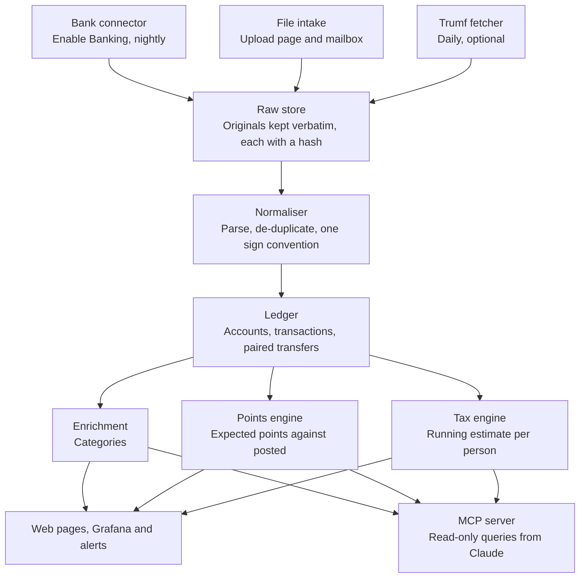

# Heimkunnskap design

Heimkunnskap is a self-hosted, read-only finance app for one Norwegian household. Bank accounts arrive automatically through Enable Banking (PSD2); card statements, pay slips, expense claims and the EuroBonus history arrive as files. Everything lands in one Postgres ledger that reports income and spending, computes expected EuroBonus points and checks them against what was posted, and keeps a running income tax estimate per person.

## Scope

It answers three questions: where the household's money goes, whether each purchase earned the most EuroBonus points it could have, and how much income tax each person owes so far this year.

In scope:

- Income and spending across bank accounts and cards, by category and payee, with moves between the household's own accounts and card bill payments left out
- Expected EuroBonus points per purchase, under each card's dated earn rule, against the points actually posted; points missed by paying with the wrong card
- Trumf purchases and receipt lines (optional)
- A running income tax estimate per person, from pay slips, loan interest, dividends and a sole proprietorship's profit, with VAT per two-month term for a VAT-registered sole proprietorship
- Questions to Claude about the data, through a read-only MCP server

Out of scope:

- Initiating payments or moving money. The app is read-only.
- Filing the tax return, the VAT return or the business's accounts. The app estimates only; the books stay where they are.
- Hosting other households' data. Each household runs its own copy (README).

## Data sources

| Source | How it is reached | Cadence |
| --- | --- | --- |
| Bank accounts | [Enable Banking](https://enablebanking.com/docs/markets/no/), a licensed PSD2 aggregator, with BankID consent per account holder, renewed every 180 days | Nightly |
| SAS EuroBonus Mastercard (SEB Kort) | Enable Banking, as "SAS EuroBonus Mastercard"; older history from its Excel export | Nightly |
| American Express (Norway) | The Excel export per billing period from americanexpress.com. Amex is not in Enable Banking's Norway list. | Monthly file |
| DNB Mastercard | The Excel export from the DNB online bank. Not available by API for personal cards. | Monthly file |
| EuroBonus account | The Excel export from sas.no (My EuroBonus, Transactions), whole history each time | Monthly file |
| Trumf | Purchases and receipt lines read from trumf.no with the household's stored login session. No official API. | Daily, optional |
| Pay slips | PDF, one layout parser per payroll system (DFØ and one private payroll layout so far) | Monthly file |
| Expense claims (reiseregning) | PDF from the employer's travel system (Unit4), text layer or OCR | As they come |
| Loan interest | Read from the bank's instalment text where it carries the split (DNB does) | Nightly |

Files are uploaded on the web app's upload page or emailed to a dedicated mailbox (trusted senders only, with the mail provider's DMARC/DKIM/SPF result required). The parser is chosen from the file's contents, not its name.

Limits that shape the design:

- **Consent renewal.** Account access lasts [180 days](https://www.finanstilsynet.no/tema/psd-2---eus-reviderte-betalingstjenestedirektiv/psd2---presiseringer-og-avklaringer-om-regelverket) after the last strong authentication. Each account holder redoes BankID about twice a year; the app reminds them.
- **History depth.** DNB returned five years; the SAS EuroBonus Mastercard about 13 months. History older than 90 days may only be readable for about an hour after BankID, so the first sync pulls everything at once.
- **Call budget.** Unattended fetches are limited to about four per account per day. One nightly run is enough.
- **Trumf retention.** Trumf keeps 12 months of purchases. Heimkunnskap keeps them from the first fetch on.

## Architecture

All sources pass through the raw store, the normaliser and the ledger, so a bank transaction and a card-file row end up in one shape before any report or points calculation reads them.

The raw store and the ledger hold data. The normaliser, pairing, categories, points engine and tax engine are code that is re-run over stored data after every sync and upload.

Three containers: Postgres, a worker (migrations on start, nightly sync, mail intake, the Trumf fetch, reminders) and the web app (pages, uploads, the BankID consent flow and `/mcp`). Grafana is optional.

## Ledger

The cards are accounts in their own right, so a card purchase and the later bill payment are two separate events, and the pairing keeps the bill out of spending.

| Table | Holds |
| --- | --- |
| `account` | One row per bank account and per card, with its bank (`aspsp_name`) |
| `consent` | One row per BankID consent: whose, which bank, expiry |
| `import_batch`, `raw_record` | Each fetch or file, and the originals, never edited |
| `txn` | The normalised transaction: integer øre, currency, original foreign amount, booking date, text, fingerprint |
| `txn_class` | Which transactions are moves between own accounts, card bill payments, saving, loan payments, reimbursements, or money lent out and repaid, each with its other side when found. Rows marked `manual` are set by hand and kept |
| `category`, `category_rule` | Spending categories, assigned by regex rules over payee and text, first match by priority |
| `lending` | Money the household lent out and a pattern for its repayments |
| `payslip`, `person`, `tax_rule`, `tax_estimate` | The tax estimate's inputs, rules per income year, and result |
| `expense_claim`, `expense_claim_line`, `txn_part` | Expense claims, matched to the card payments they reimburse, and the split of the deposit that paid them |
| `business_expense`, `business_rule`, `business_vat` | A sole proprietorship's expenses (tagged by hand or rule) and VAT |
| `points_card`, `earn_rule`, `earn_exclusion`, `points_expected`, `eb_txn` | Cards and their dated earn rules, expected points per purchase, and the EuroBonus history |
| `trumf_txn`, `trumf_line`, `trumf_partner`, `trumf_session` | Trumf purchases, receipt lines, partner codes, and the stored login |

Reports read views in the `report` schema; Grafana and the MCP server see nothing else.

## Correctness rules

1. **Keep the originals.** Every API response and uploaded file is stored verbatim with its hash. Parsers can then be fixed and re-run without downloading anything again.
2. **Import is idempotent.** Each row gets a fingerprint of account, date, amount, text and an occurrence counter. The counter keeps two identical purchases on one day as two rows, and overlapping downloads add nothing.
3. **Transfers are not spending.** Paying a card bill appears on both the bank and the card. The pairing marks both sides, so no purchase is counted twice. How each bank words these payments is its bank profile (`heimkunnskap/banks/`).
4. **Money is exact.** Amounts are integer øre with a currency code and one sign convention. Foreign purchases keep the original amount and currency.
5. **Files check themselves.** Card files, pay slips and expense claims are checked against their own totals; a file that does not add up is refused rather than stored wrong.

Only booked transactions are imported. Pending ones change reference and amount before they settle.

## Points engine

- **Earn rules are data.** Each card's points per 100 kr at home and abroad, a yearly cap, and the delay before points post, each with valid-from and valid-to dates. Rules are entered from the issuers' current terms, not hard-coded.
- **Exclusions are data.** Payments that earn nothing (Vipps to a person, crowdfunding, card fees) are regex rules on the bank text.
- **A point is a point.** Points are not given a krone value. Reports count points and kroner side by side.
- **Reconciliation.** Expected points per card and posting month are compared with the points in the EuroBonus history.
- **Best card.** Each purchase is compared with what the best card would have earned. A card that is not accepted everywhere (American Express) counts only at merchants where it has been used.
- **Award refunds.** A changed or cancelled award booking comes back from SAS as a refund of the same points. Each refund is paired with its booking and both are left out, so award spending is not inflated by rebookings.

## Income tax estimate

The app keeps a running income tax estimate for each person. It is a planning figure: Skatteetaten's assessment is what counts.

| Input | Source |
| --- | --- |
| Salary, benefits, pension contribution and tax withheld | The newest pay slip per employer, year to date, projected to year end |
| Loan interest | The interest part of loan instalments, split between spouses as set |
| Dividends | Bank text, counted without the shielding deduction |
| Business profit | Deposits to the business income account less their VAT, less tagged business expenses excluding VAT |

The rates are a `tax_rule` row per income year (2025 and 2026 so far). The 2025 rules reproduced a real 2025 assessment to the krone.

Design rules:

- **Per person.** Tax is assessed per person. Spouses may split shared loan interest freely; the share is a setting.
- **Watch the year-end figure.** Withholding is not spread evenly over the year: half tax in December (or November, which the estimate recognises from the slip), none in June for table withholding.
- **Profit stacks on salary.** Business profit is taxed at the top of the person's scale and gets no minimum deduction.
- **The owner's tag decides.** A business expense counts when tagged, with its VAT rate and business share; the app does not ask for receipts. Keeping the receipts the Bookkeeping Act requires is the owner's business.
- **VAT per term.** Output VAT from deposits (20% of a deposit that includes 25% VAT) from the registration date, input VAT from tagged expenses, payments and refunds per two-month term, and reminders before each deadline.

Not covered: wealth tax, gains on shares and funds sold, student loan interest (Lånekassen's annual statement has it).

## MCP server

A read-only MCP server lets Claude query the ledger: `finance_report`, `sync_status`, `import_log`, `sql_query` and `tax_estimate`. See `docs/mcp-pattern.md`.

- **Read-only twice over.** No write tools, and a database login that may read only the report views listed in `MCP_VIEWS`.
- **Query limits.** A statement timeout and a row cap on `sql_query`.
- **Access.** The reverse proxy admits only Anthropic's outbound range on the MCP path; the app then checks a bearer token.
- **Audit.** Every call is logged with time, tool and arguments.
- **Answers leave the house.** Whatever a tool returns becomes part of that Claude conversation.

## Security

The app holds a full record of household spending, so its only public surface is the read-only MCP endpoint, and it stores no bank password.

- **No stored bank credentials.** Bank access is by BankID consent through Enable Banking. Card data arrives as files.
- **One key to protect.** The Enable Banking application's private key, together with an active consent, can read transactions. It lives in a root-only file outside the database and goes into the encrypted backup.
- **Read-only by design.** Only account information is requested. Payment initiation is never enabled.
- **One public endpoint.** The web app, database and Grafana stay on the LAN and VPN. The BankID consent flow also stays on the LAN: the bank sends the browser back to the app. The web app has no sign-in of its own, so it checks the client's network as the reverse proxy does.
- **The raw store is sensitive.** It contains complete statements and pay slips. It is covered by the same encryption at backup as the database.
- **The Trumf login.** The fetcher stores trumf.no's session cookie, which is a login to the Trumf account. It sits in a table no report view or read-only role can see.
- **Pay slips carry national identity numbers.** Parsers extract amounts only; the PDFs stay in the raw store, never reachable through MCP.
- **Mail intake trusts the provider's checks.** Only allowlisted senders, and only when the mail provider's DMARC (or aligned DKIM/SPF) result passed.

## Sources

Facts were taken from these pages in November 2026. Terms and rates change, so re-check before relying on a figure.

- [Enable Banking: Open Banking specifics in Norway](https://enablebanking.com/docs/markets/no/)
- [Enable Banking: frequently asked questions](https://enablebanking.com/docs/faq/), for history limits, linked accounts and fetch limits
- [Finanstilsynet: PSD2 presiseringer og avklaringer](https://www.finanstilsynet.no/tema/psd-2---eus-reviderte-betalingstjenestedirektiv/psd2---presiseringer-og-avklaringer-om-regelverket), for the 180-day rule
- [Kredittkortlisten: Slik bruker du Trumf-bonus](https://www.kredittkortlisten.no/kredittkortskolen/trumf-kurs/bruk-trumf-bonus-smart/), for the Trumf conversion rate
- [Smarte Penger: skatt på lønnsinntekt](https://www.smartepenger.no/103-skatt/646-skatt-pa-lonnsinntekt) and [skatt på næringsinntekt](https://www.smartepenger.no/103-skatt/2982-skatt-pa-naeringsinntekt)
- [Smarte Penger: fordeling av inntekt og fradrag](https://www.smartepenger.no/103-skatt/1901-fordeling-av-inntekt-og-fradrag), for splitting interest
- [Skatteetaten: VAT deadlines](https://www.skatteetaten.no/en/rettskilder/type/handboker/skatteforvaltningshandboken/2021/kapittel-8-opplysningsplikt-for-skattepliktige-trekkpliktige-mv/ID-8-3.001/ID-8-3.020/)
- [Skatteetaten: registering for VAT](https://www.skatteetaten.no/bedrift-og-organisasjon/avgifter/mva/slik-fungerer-mva/ma-jeg-registrere-meg-i-merverdiavgiftsregistret/)
- [fredrsat/trumf-connector](https://github.com/fredrsat/trumf-connector), for Trumf retention and receipts
